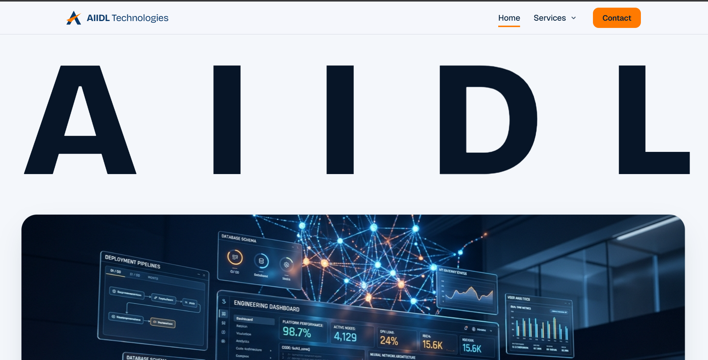
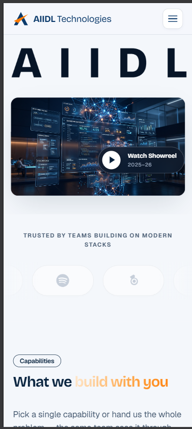

# AIIDL Technologies — Digital Engineering & Product Studio

A modern, high-craft website built for **AIIDL Technologies** showcasing bespoke software engineering, cloud architectures, web & mobile applications, and applied AI systems.

---

## Quick Start

```bash
# 1. Install dependencies
npm install

# 2. Run local development server
npm run dev

# 3. Open in browser
# http://localhost:3000

# 4. Production build check
npm run build && npm start
```

* **Node Version**: Node.js 20+ recommended.
* **Fonts**: Self-hosted through npm via `@fontsource-variable` (zero external network calls required at build time).

---

## Tech Stack

* **Framework**: [Next.js 16](https://nextjs.org/) (App Router, Turbopack)
* **Language**: TypeScript (`strict: true`)
* **Styling**: Vanilla CSS with custom design tokens (`app/globals.css`)
* **Typography**: `@fontsource-variable/bricolage-grotesque` (display & monumental headers) and `@fontsource-variable/geist` (interface body text)
* **Animation & Physics**: Pure CSS3 transforms, `requestAnimationFrame`, and mathematical cursor wave calculations (zero bulky third-party animation libraries).

---

## Routes & Architecture

| Route | Purpose & Interactive Features |
|---|---|
| **`/`** (Home) | **Full Studio Experience**: <br>• **Site Preloader**: Digital `00% → 100%` counter with studio telemetry and theatrical curtain-split entrance.<br>• **Monumental Studio Hero**: Wall-to-wall `AIIDL` typography with real-time cursor-drag liquid wave physics (`-54px` wave lift, dynamic tilt, and crest glow).<br>• **3D Software Engineering Showreel**: Floating glass UI architecture and AI nodes with RGB chromatic aberration slice flicker on hover, and an expandable 4K lightbox modal.<br>• **Stadium Capsule Marquee**: Infinite ribbon with rounded stadium pills (`border-radius: 9999px`) featuring clean vector platform marks (Spotify, Blender, Cloud, Bing Copilot, Loom, Cloudflare, Shopify, GitHub, Docker, Supabase) and hover brand elevation.<br>• **Interactive Capabilities Showcase**: 4-row accordion with left preview thumbnails, `//01` code prefixes, expandable row descriptions, and floating diagonal popover cards (`↗`).<br>• **Speed & Reliability Metrics**: Live SLA chips, repo handover guarantees, and sprint velocity metrics.<br>• **Interactive Concept Projects**: Live interactive velocity burndown chart with day-by-day toggle nodes (`Mon`–`Fri`).<br>• **4-Stage Delivery Process**: Transparent roadmap (Scope → Weekly Builds → Launch → Handover).<br>• **Agency Comparison Matrix**: AIIDL vs. traditional agencies & freelancers.<br>• **Client Testimonials & FAQs**: Native accessible FAQ accordions with keyboard support.<br>• **Closing Studio CTA & Modern Footer**: 4-column footer with live status beacon (`● Available for New Projects`), IST timezone badge, and smooth scroll-to-top. |
| **`/services`** | **Capabilities Overview**: Full interactive services showcase with left thumbnail previews, capability breakdown, and direct enquiry links. |
| **`/services/custom-software`** | **Service Detail Deep Dive**: In-depth breakdown of bespoke web and platform engineering: who it helps, client deliverables, 3-step agile execution, native `details/summary` FAQs, and direct project enquiry CTA. |
| **`/contact`** | **Production-Ready Enquiry**: Structured project inquiry page with client-side form validation (empty states, whitespace detection, valid email regex), smart query-string topic prefilling (`?topic=cloud-devops`, `?topic=web-mobile`), and 24-hour turnaround confirmation (*"Thank you! Our team will connect with you shortly."*). |

---

## Design Concept & Philosophy

### 1. Monumental Typographic Presence (Zajno-Inspired)
* **Wall-to-Wall Display Typography**: The hero section showcases a monumental `AIIDL` title in ultra-bold Bricolage Grotesque (`clamp(6rem, 23vw, 27rem)`), commanding immediate editorial presence.
* **Interactive Cursor Wave Physics**: Moving or dragging across the letters on a trackpad or mouse calculates distance vectors in real time, lifting each letter along a smooth Gaussian bell curve (up to `-54px` crest) with proportional rotation tilt and electric orange highlight glow.

### 2. Cinematic Preloader & Theatrical Entrance
* A digital telemetry preloader (`00%` to `100%`) runs smoothly on initial load, displaying studio coordinates (`28.6139° N, 77.2090° E · NEW DELHI · GLOBAL`).
* Upon completion, top and bottom curtains split vertically with a `cubic-bezier(0.85, 0, 0.15, 1)` easing curve, orchestrating a staggered entrance of the monumental typography and showreel stage.

### 3. Digital Glitch & Chromatic Aberration
* Hovering the software engineering showreel card triggers multi-layer RGB chromatic displacement slices (cyan, magenta, and yellow color separation) with scanline CRT flicker, creating a tactile creative-tech agency feel.
* Clicking the centered **Watch Showreel · 2025–26** trigger opens an interactive 4K video lightbox modal with project descriptions and direct CTA triggers.

### 4. Infinite Stadium Capsule Marquee
* A continuous looping marquee ribbon featuring stadium pills (`border-radius: 9999px`) rendered with subtle translucent borders.
* Brand marks (Spotify, Blender, Cloud, Bing Copilot, Loom, Cloudflare, Shopify, Docker, GitHub, Supabase) transition from neutral monochrome to their signature brand colors and elevate smoothly on hover.

### 5. Interactive Capabilities Hover Table
* Replaces generic static cards with an editorial table:
  * **Left Thumbnail**: Live visual thumbnail box revealing project screenshots on hover.
  * **Center Stage**: Display title with `//01` prefix and a floating diagonal popover card.
  * **Right Column**: Expanding descriptive text and micro-deliverable tags.

### 6. Design System, Contrast & Accessibility (WCAG AA)
* **Curated Palette**: Warm off-white paper (`#F4F7FB`), deep navy (`#071F3A`), dark charcoal (`#071527`), and an electric orange accent (`#FF7A00`).
* **Contrast Compliance**: Body text and headlines meet WCAG AA standards against their respective light and dark backgrounds.
* **Accessible Navigation**: Geometric 44×44px animated hamburger button on mobile devices morphing into an `'X'` when active, with complete keyboard `Esc` and screen-reader accessibility (`aria-expanded`, `.sr-only`).
* **Motion Accessibility**: Full compatibility with `@media (prefers-reduced-motion: reduce)`, disabling infinite ribbons, auto-scroll transforms, and particle ripples for users who prefer static presentations.

---

## Form Validation & Behavior

* **Client-Side Validation**: Required fields (Name, Email, Project Details) validate in real-time. Whitespace-only submissions and malformed emails trigger inline error messages while retaining user input.
* **Auto-Prefill Parameter**: Navigating from `/services` or `/services/custom-software` with `?topic=...` automatically pre-fills the message field with relevant context.
* **Submission State**: Confirms with: *"Thank you! Our team will connect with you shortly."* and commits to a 24-hour response turnaround.

---

## Verification & Testing Checklist

- [x] All 4 routes (`/`, `/services`, `/services/custom-software`, `/contact`) statically pre-render with Turbopack (0 build errors, 0 warnings).
- [x] Responsive layout verified from mobile (390px, 457px) to desktop (1152px, 1396px, 1600px).
- [x] Site preloader completes smoothly and triggers the hero entrance animation.
- [x] Monumental `AIIDL` letters wave dynamically when dragging the cursor across the text.
- [x] Showreel video card triggers chromatic aberration RGB slice flicker on hover, and clicking opens the 4K lightbox modal.
- [x] Stadium capsule marquee scrolls continuously and pauses on hover.
- [x] Interactive services accordion reveals left image thumbnail and floating popover card.
- [x] Mobile hamburger menu opens, morphs into 'X', closes on link tap, outside click, and `Esc` key.
- [x] Contact form validates correctly and displays submission confirmation.


- desktop ss




- mobile ss
